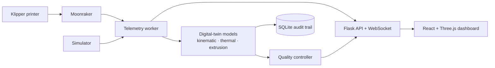

<p align="center">
  
</p>

<h1 align="center">Indus3D</h1>

<p align="center"><strong>A real-time digital twin and quality-control dashboard for Klipper-based FDM 3D printers.</strong></p>

<p align="center">
  <a href="LICENSE"></a>
  
  
  
  
</p>

Indus3D runs alongside Klipper and Moonraker to model a printer's motion, thermal behaviour, and extrusion in real time. It turns the result into a live 3D dashboard, an auditable print history, and—where explicitly enabled—conservative closed-loop quality corrections.

It is designed to be a companion to the existing Klipper stack, not a replacement. Indus3D never asks the browser to connect to Moonraker directly and does not alter Klipper's core operation.

> **Project status:** Active development. The dashboard and digital twin have been exercised during real prints; some advanced quality and vision capabilities remain experimental. See [Validation and scope](#validation-and-scope) before relying on an automated correction.

## Why Indus3D?

- **See the print as a system.** Follow the commanded toolpath, live toolhead, temperatures, flow, alerts, and corrective actions in one place.
- **Use a model, not just a status feed.** Kinematic, thermal, and extrusion models run alongside live telemetry to identify drift and quality risks.
- **Develop without hardware.** A complete Benchy/calibration-cube simulator makes the dashboard and API testable off-printer.
- **Fleet Command.** Manage multiple printers side-by-side in an integrated hub.
- **Root-Cause Playbacks.** If a print fails, automatically replay the exact G-code and camera snapshots from the final 10 seconds to discover what went wrong.
- **Keep the printer stack intact.** Klipper and Mainsail remain untouched; Indus3D communicates through its own Flask API and Moonraker proxy.
- **Build openly and honestly.** Validated behaviours and working hypotheses are documented separately so contributors know what needs evidence.

## What it includes

| Area | Available now | Notes |
| --- | --- | --- |
| Live digital-twin dashboard | Yes | 3D toolpath/toolhead view, progress, temperatures, console, and telemetry |
| Kinematic, thermal, and extrusion models | Yes | Runs in parallel with printer telemetry |
| Simulation mode | Yes | Benchy and calibration-cube print simulations with no printer attached |
| Audit trail | Yes | Per-tick snapshots, odometry, and actions logged to SQLite |
| Quality corrections | Available with care | `M221`, `M220`, and input-shaper actions are configurable and should be validated per machine |
| Fleet management | Yes | Manage and monitor multiple networked printers side-by-side |
| Incident replay | Yes | Replays captured camera frames and G-code around a recorded print failure |
| Extensibility plugins | Yes | Drop-in Python backend plugins and UI extensions |
| Print cost analytics | Yes | Spoolman integration for per-print cost calculations |
| Multi-camera dashboard | Available | Works with Crowsnest-compatible streams |
| Calibration workflows | In development | Bed, PID, flow, and input-shaper tooling is evolving |
| Camera/YOLO defect inspection | Roadmap | Pipeline is present but not yet wired into the application |
| **Research-driven physics models** | **Yes (v2.0)** | **6 analytical control modules from 100+ papers — O(1), Pi-safe. See below.** |

## Quick start

### Run the full simulator

You only need Python and Node.js; no printer is required.

```bash
# Terminal 1 — API + simulated printer
cd backend
python -m venv .venv
source .venv/bin/activate
pip install -r requirements.txt
python main.py --sim
```

```bash
# Terminal 2 — dashboard
cd frontend
npm install
npm run dev
```

Open [http://localhost:5173](http://localhost:5173). Enter `TEST` in the G-code terminal to begin a demonstration print.

### Run against a Klipper printer

1. Copy `backend/.env.example` to `backend/.env`.
2. Set `MOONRAKER_HOST` and `MOONRAKER_PORT` for the printer.
3. Start the backend with `python main.py` and the frontend with `npm run dev`.

Indus3D accesses Moonraker only through the backend. Do not expose Moonraker directly to the browser.

### Deploy to a Raspberry Pi

```bash
chmod +x deploy_to_pi.sh
./deploy_to_pi.sh
```

The default deployment serves the dashboard on port `3000`; Mainsail and Moonraker remain on their existing ports. An optional [Nginx configuration](deploy/nginx-indus3d.conf) can serve the built UI and proxy HTTP/WebSockets through port 80.

## Architecture



| Service | Port | Purpose |
| --- | ---: | --- |
| Mainsail | 80 | Existing printer interface — unchanged |
| Moonraker | 7125 | Existing Klipper API — accessed only by the backend |
| Indus3D API | 5001 | Flask API and telemetry WebSocket |
| Indus3D UI | 3000 | Production Pi deployment |
| Vite | 5173 | Local development server |

## Physics-Based Quality Control (v2.0)

Six analytical control modules derived from 100+ research papers are integrated
into the live quality-control loop. All run as O(1) scalar arithmetic — no
inference engine, no GPU, safe for Raspberry Pi.

| Module | Physics | Control action | New metric |
|---|---|---|---|
| **Non-Newtonian backpressure** | Cross-Arrhenius shear-thinning ΔP across 3 nozzle zones | CLOG/STRIP detection via TMC current ratio | `nozzle_status`, `pressure` |
| **Sintering & adhesion healing** | Costa lumped-capacitance cooling + Gauss-Legendre D_h integral | Trim fan if D_h < 0.95 to extend healing window | `adhesion_score` |
| **Graetz undercooling** | Gz number → nozzle exit core thermal deficit ΔT | Feedforward M104 boost (max +10°C) | `undercooling_c` |
| **Warpage observer** | ADXL Z-stress → compliance spring F_z → Δh_warp | Z-hop babystep if Δh > 0.35 mm | `warpage_mm` |
| **TVIST shaper** | Viscoelastic damping growth + f_d(m_part) | SET_INPUT_SHAPER with live ζ tracking | `zeta`, `shaper_hz` |
| **Surface roughness Ra** | Kinematic scallop + empirical response surface | M220 perimeter speed trim if Ra > target | `ra_predicted_um` |

See [SETUP.md — Section 10](docs/SETUP.md#10-physics-based-quality-control--configuration) for configuration
and [ROADMAP.md](docs/ROADMAP.md#research-driven-mathematical-models-v20) for the full mathematical derivations.

## Validation and scope

### Validated

- Live dashboard tracking during real prints, including the toolhead in the 3D viewport
- Lag and under-/over-extrusion alerts during active prints
- Quality commands (`M221`, `M220`, and `SET_INPUT_SHAPER`) appearing in the terminal/audit stream
- Offline Benchy and calibration-cube simulation
- SQLite-backed odometry and print-history logging

### Still being validated

- Measurable benefits from variable input shaping on a well-tuned machine
- Using flow-ratio correction to identify physical under-extrusion rather than slicer configuration issues
- Vibration-based fault detection and the camera/YOLO inspection pipeline
- Sintering D_h threshold (0.95) against peel-strength coupon tests across filament types
- Graetz undercooling boost magnitude vs actual melt temperature measurements
- Warpage detection accuracy — ADXL Z-stress proxy vs a dedicated load cell measurement
- Surface roughness Ra model vs profilometer measurements on real prints

The flow model compares commanded extrusion with expected geometry. A stepper has no force feedback, so it cannot on its own prove a partial clog or other physical extrusion fault. Read [the development notes](docs/DEVELOPMENT.md) for the detailed limits of every feature.

## Documentation

- [Development and validation notes](docs/DEVELOPMENT.md)
- [Garuda3D technical overview](docs/GARUDA3D_OVERVIEW.md)
- [Roadmap and good first contributions](docs/ROADMAP.md)
- [Contributing guide](CONTRIBUTING.md)
- [Security policy](SECURITY.md)

## Contributing

Contributions are welcome—from documentation and simulator improvements to new printer profiles, dashboard polish, test coverage, and hardware validation reports. Start with the [contributing guide](CONTRIBUTING.md), then look for issues labelled **good first issue** or **help wanted**.

If you use Indus3D with a printer, sharing the configuration and a short outcome report is especially valuable. Please remove private network addresses, API keys, and camera URLs before posting.

## Acknowledgements

Indus3D is possible because of the projects it builds alongside:

- [Klipper](https://github.com/KevinOConnor/klipper) and its contributors
- [Moonraker](https://github.com/Arksine/moonraker), the API Indus3D talks to
- [Mainsail](https://github.com/mainsail-crew/mainsail) and [Crowsnest](https://github.com/mainsail-crew/crowsnest), whose printer-dashboard and camera-streaming work set a high bar

## License

Released under [GPL-3.0](LICENSE), consistent with Klipper and Mainsail.
